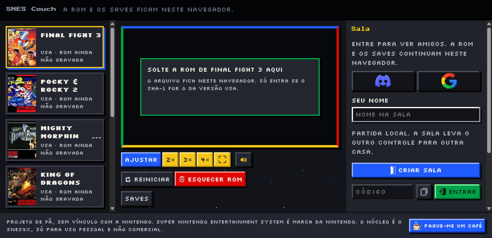
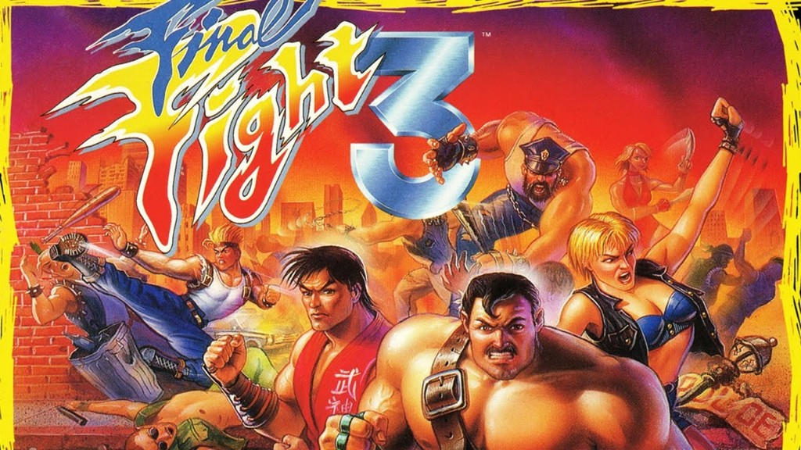
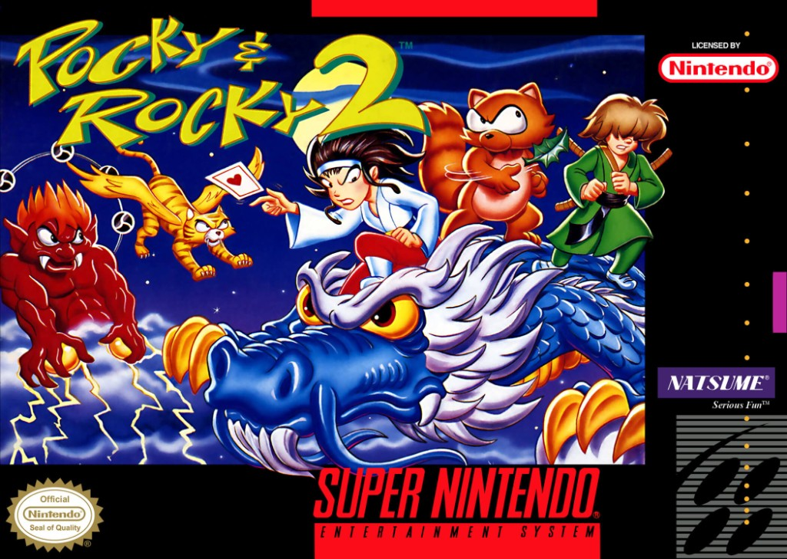
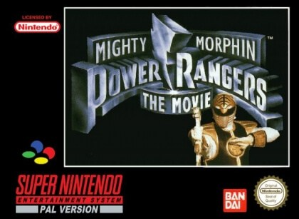
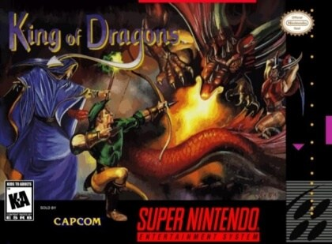
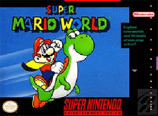
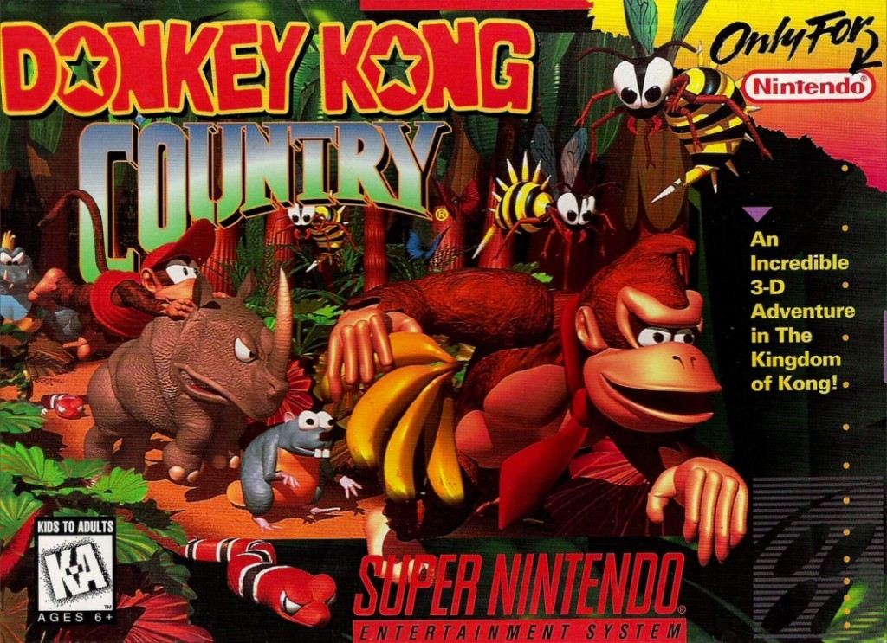
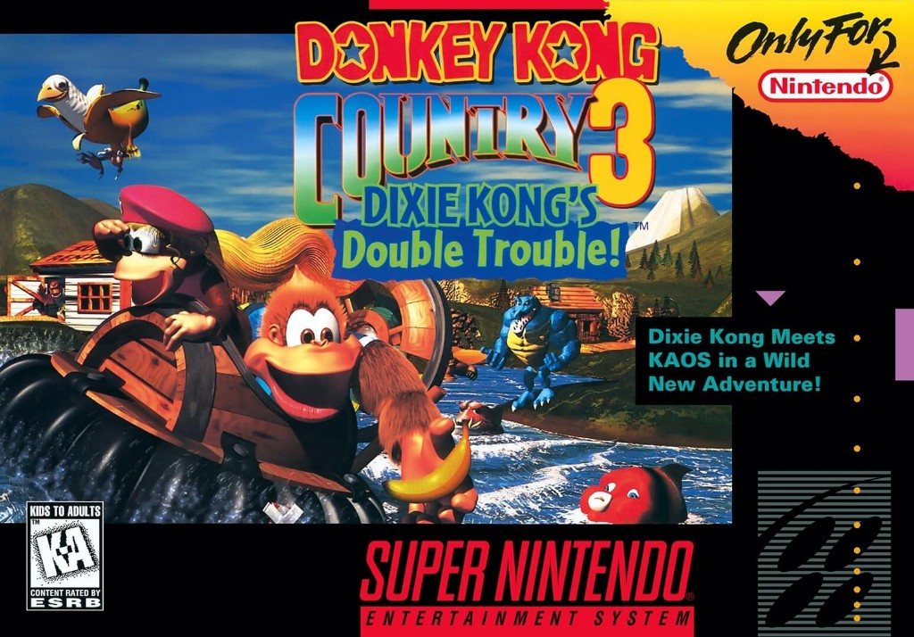
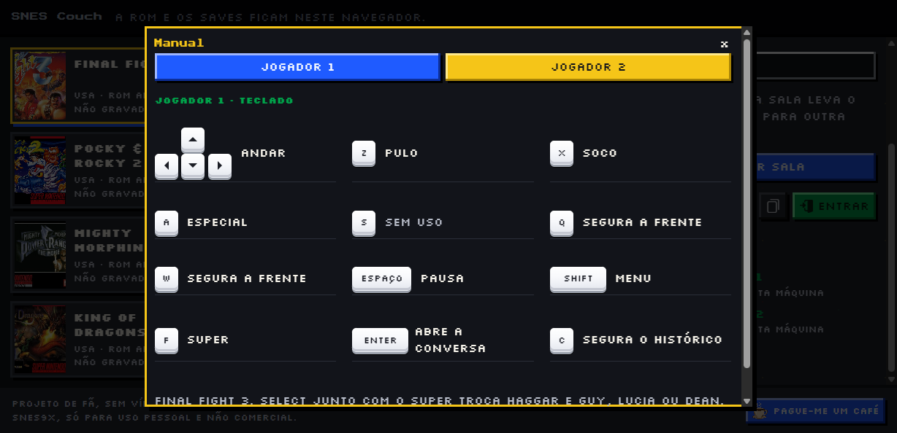

# SNES Couch

Dois jogadores, cada um na sua casa, no mesmo jogo de Super Nintendo. Cada navegador roda o jogo. A ROM fica gravada nele. Entre as duas casas passam os botões.



Projeto de fã, sem vínculo com a Nintendo. Super Nintendo Entertainment System é marca da Nintendo. Este repositório não inclui ROM e não indica onde conseguir uma.

Na primeira visita o site abre um passo a passo. Dá para pular e ir direto ao jogo.

## Jogar

1. Escolhe um jogo da lista.
2. Solta a ROM da versão USA na área do meio. O arquivo só entra se o SHA-1 for o da lista. Um cabeçalho de 512 bytes, comum em arquivo `.smc`, é retirado quando a ROM de dentro confere. O arquivo fica neste navegador.
3. Nesta máquina, os dois teclados já jogam juntos. Um controle USB entra no lugar de um teclado.
4. Em duas casas, um cria a sala e manda o código de 5 letras. O outro entra com o mesmo jogo e a mesma ROM.

A conta serve para os amigos. Entra com Discord ou Google. Cada conta tem um código de 6 caracteres: manda o seu, pede amizade com o do outro e chama a pessoa para a sala. Uma sala com código também abre sem conta. A ROM e os saves continuam no navegador de cada um.

O save fica neste navegador, com um print da tela. Na sala, carregar um save pede confirmação dos dois. Reiniciar a partida na sala também pede os dois.

No celular, um toque na tela do jogo abre o controle. O Chrome oferece instalar o site na tela de início. A tela cheia pede o modo paisagem quando o navegador permite.

A conversa da sala abre com Enter, no canto do jogo. Segurar C mostra o histórico.

**Outro jogo**, o último item da lista, aceita qualquer ROM de Super Nintendo que o núcleo reconheça. Essa partida fica só nesta máquina. A sala usa um jogo da lista, porque os dois lados conferem o mesmo arquivo.

## Jogos da sala

A sala aceita estes sete, sempre na versão USA. O SHA-1 de cada um está em [`packages/catalog/games.json`](packages/catalog/games.json). Cada jogador solta a própria cópia. O arquivo não viaja.

| | Jogo | Os dois jogam |
| --- | --- | --- |
|  | **Final Fight 3** | Briga de rua. Soco, pulo e especial. A tecla Super solta o golpe. Haggar, Guy e Dean precisam estar segurando o inimigo. Select junto com o Super troca Haggar e Guy, Lucia ou Dean. |
|  | **Pocky & Rocky 2** | Tiro em dupla. R joga o parceiro. |
|  | **Mighty Morphin Power Rangers: The Movie** | Briga. Ataque, pulo e especial. |
|  | **King of Dragons** | Briga. Arma, pulo, magia e escudo. |
|  | **Super Mario World** | Mario e Luigi na mesma fase. |
|  | **Donkey Kong Country** | Donkey Kong e Diddy Kong. |
|  | **Donkey Kong Country 3** | Dixie Kong e Kiddy Kong. |

O botão **Manual** traduz cada tecla para a ação daquele jogo e, quando há controle USB, desenha o Super Nintendo com uma linha até o botão.



## Controles

Na mesma máquina, os dois teclados jogam ao mesmo tempo.

| Botão do Super Nintendo | Jogador 1 | Jogador 2 |
| --- | --- | --- |
| Direções | Setas | I K J L |
| B | Z | N |
| Y | X | M |
| A | A | G |
| X | S | H |
| L | Q | U |
| R | W | O |
| Start | Espaço | P |
| Select | Shift esquerdo | V |
| Super | F | ; |

Enter abre a conversa. C segura o histórico. O Super só entra nos jogos que têm esse atalho. Hoje, Final Fight 3.

Na sala, cada casa usa o teclado do jogador 1, o controle ligado nessa máquina, ou o toque. O manual mostra só o controle dessa casa.

O navegador reconhece controle de Super Nintendo, fliperama, PlayStation, Xbox e o controle USB comum. Dois controles ocupam os dois lugares e o teclado sai. Um controle ocupa um lugar e o outro jogador fica com as setas.

## Como a sala se mantém junta

Os dois navegadores rodam o mesmo Snes9x, com a mesma ROM. A cada quadro, cada lado manda os botões que apertou. O quadro só anda quando os dois conjuntos de botões daquele quadro chegaram. A espera fica entre 2 e 8 quadros, conforme o ping. Se as duas cópias divergem, a sala fecha. Cria outra.

A imagem fica em cada navegador. O que atravessa a rede são os botões, por WebRTC. O servidor cria a sala, a conta e os amigos, e encaminha o sinal da ligação. Atrás de CGNAT a ligação direta pode falhar. Aí entra um servidor TURN.

## Contribuir

O código está público neste repositório. Dá para ler, rodar na sua máquina e mandar uma alteração. O núcleo é o [Snes9x](https://github.com/snes9xgit/snes9x), só para uso pessoal e não comercial. Esse limite vale para o site inteiro.

### Rodar

```bash
npm install
npm run dev
```

Abre http://127.0.0.1:5173. Os dois lados da sala podem ser duas janelas, cada uma com a própria ROM USA.

Se a página avisar que não está isolada, faltam os cabeçalhos `Cross-Origin-Opener-Policy` e `Cross-Origin-Embedder-Policy`. Sem eles o navegador não libera a memória compartilhada do núcleo. O `npm run dev` já manda esses cabeçalhos.

A ligação do jogo tenta o caminho direto e um STUN. Para testar atrás de CGNAT, copia `apps/signal/.dev.vars.example` para `apps/signal/.dev.vars` e preenche `TURN_URL`, `TURN_USERNAME` e `TURN_CREDENTIAL`. O mesmo arquivo recebe as chaves de Discord e Google, se quiser amigos no ambiente local, e o `MERCADO_PAGO_URL` do botão de café. Sem o link, o botão fica escondido. O arquivo `.dev.vars` não entra no git.

### O que tem aqui

| Pasta | O que é |
| --- | --- |
| `apps/web` | A página. Vite, o canvas, o manual, os saves neste navegador. |
| `apps/signal` | O Worker. Sala, conta, amigos e o sinal da ligação WebRTC. |
| `packages/net` | O lockstep: o quadro só avança com os botões dos dois lados. |
| `packages/catalog` | A lista de jogos e o SHA-1 da versão USA. |
| `core` | O Snes9x compilado para WebAssembly. |
| `test` | Os testes, inclusive o de determinismo. |

### Testes

```bash
npm test
```

O teste de determinismo usa uma ROM escrita neste repositório, não um jogo da Nintendo. Cada jogo do catálogo passa pelo mesmo teste se a sua ROM estiver em `local-roms/`, ou se `SNES_ROM_DIR` apontar para a pasta dela. O arquivo da ROM não entra no git.

### Incluir um jogo na sala

1. Confere a ROM USA e anota o SHA-1 e o tamanho em bytes, sem o cabeçalho de 512 bytes.
2. Acrescenta uma entrada em `packages/catalog/games.json`: `id`, `title`, `region` (`USA`), `sha1`, `bytes` e `players` (`2`).
3. Coloca a capa em `apps/web/public/covers/<id>.jpg`.
4. Se souber o que cada botão faz, descreve em `apps/web/src/actions.ts`. O manual usa essa tabela.
5. Roda o teste de determinismo com a ROM fora do git.

A capa é a arte de caixa do jogo, para a pessoa reconhecer o cartucho. A ROM continua de fora.

### Núcleo

Para gerar o WebAssembly de novo: `npm run build:core`, com o Emscripten e o código em `core/third_party/snes9x`. Neste Windows o script chama o WSL. A licença do Snes9x está em `core/SNES9X_LICENSE.txt`. O binário inclui o filtro `snes_ntsc`, sob a LGPL.

### O que fica de fora de propósito

O save na nuvem está desligado. A conta guarda o nome, a sessão e os amigos. O arquivo do save, e o print da tela, ficam neste navegador. O caminho antigo responde que a nuvem está desligada. Deixa assim.

ROM de jogo comercial não entra no repositório, nem um link de onde baixar.

## Licença

O núcleo é o Snes9x. O uso permitido é pessoal e não comercial, com o aviso de copyright que está em `core/SNES9X_LICENSE.txt`. Partes do filtro de vídeo seguem a LGPL. A fonte da página está sob a SIL Open Font License, em `apps/web/public/fonts/OFL.txt`.

O código da página e do servidor está neste repositório para quem quiser estudar, rodar e propor mudança. Isso não cobre a ROM, a arte dos jogos nem a marca da Nintendo.
